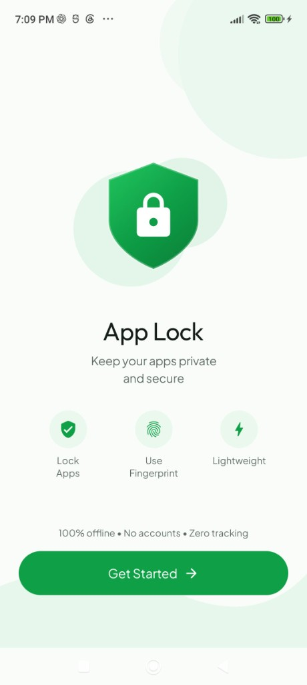
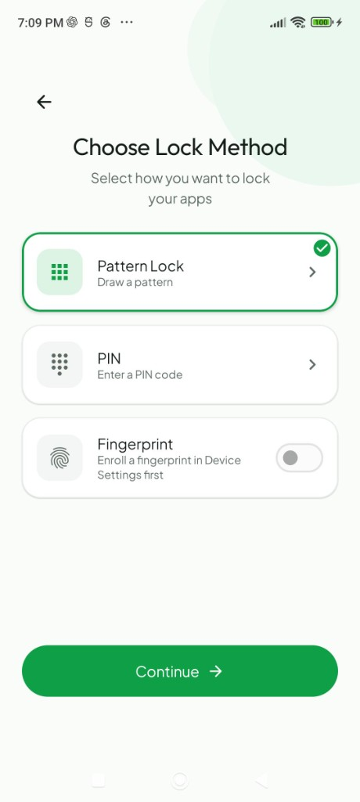
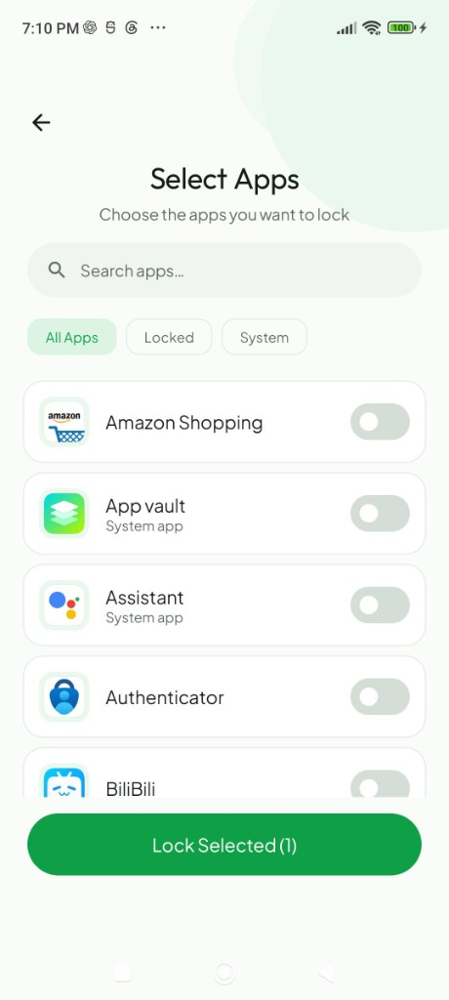
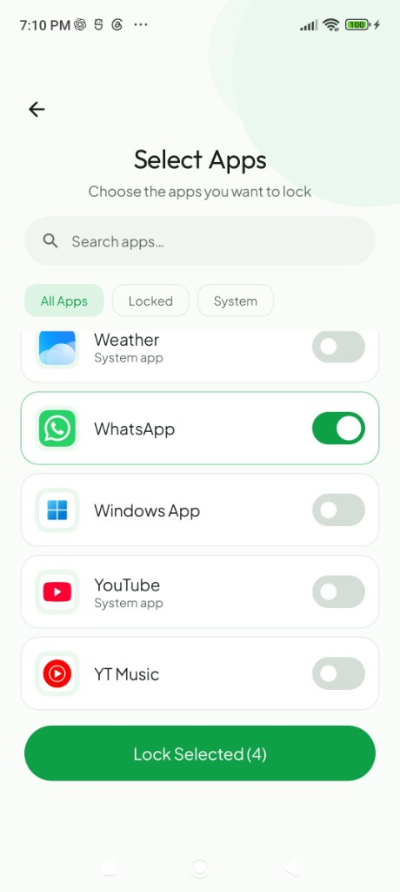
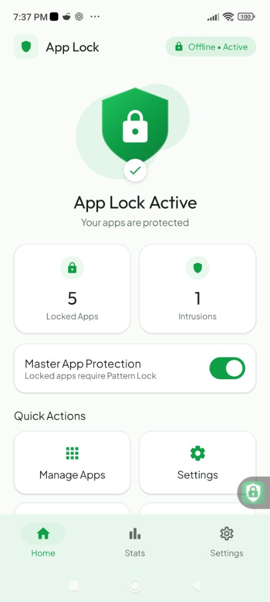
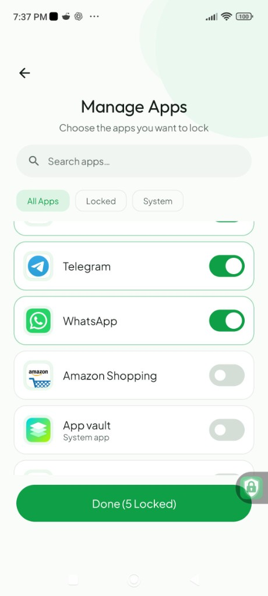

<h1 align="center">App Lock</h1>

  Lock the apps you choose with a pattern, PIN, or fingerprint. 
  The locker stays on the phone. No account. No tracking.

  <a href="#walkthrough">Walkthrough</a>
  &nbsp;·&nbsp;
  <a href="#privacy">Privacy</a>
  &nbsp;·&nbsp;
  <a href="#on-device-vault">On-device vault</a>
  &nbsp;·&nbsp;
  <a href="#run-locally">Run locally</a>

## Walkthrough

<table>
  <tr>
    <td align="center" valign="top" width="33%">
        
      <b>1. Get started</b> 
      Open the app. Nothing to sign up for.
    </td>
    <td align="center" valign="top" width="33%">
        
      <b>2. Choose a lock</b> 
      Pattern, PIN, or fingerprint.
    </td>
    <td align="center" valign="top" width="33%">
        
      <b>3. Browse apps</b> 
      Search, or filter locked and system apps.
    </td>
  </tr>
  <tr>
    <td align="center" valign="top" width="33%">
        
      <b>4. Lock your picks</b> 
      Turn on each app you want protected.
    </td>
    <td align="center" valign="top" width="33%">
        
      <b>5. Protection on</b> 
      See locked apps and failed attempts.
    </td>
    <td align="center" valign="top" width="33%">
        
      <b>6. Manage later</b> 
      Add or remove apps whenever you want.
    </td>
  </tr>
</table>

## Privacy

| | | |
| --- | --- | --- |
| **Offline** | **Stays on the phone** | **Screen stays private** |
| No `INTERNET` permission. OkHttp, Retrofit, and Firebase are not in the app, and the code makes no HTTP calls. | No analytics, crash reporting, ads, or accounts. Cloud backup and device transfer are off. | The accessibility service only sees which app opened. It does not read screen text, messages, or keystrokes. |

Checked against the manifest, the app source, and the unit test that rejects an `INTERNET` permission.

## On-device vault

One file, `applock_vault.enc`, sits in the app's private storage so the lock still works after you leave. It is encrypted with AES-256-GCM. The key is in the Android Keystore.

| Kept in the vault | How |
| --- | --- |
| Lock settings | Method, fingerprint on or off, auto-lock, screen-capture protection |
| Locked apps | Package names only |
| Pattern or PIN | Salted PBKDF2-HMAC-SHA256 hash, 120,000 iterations. The pattern and PIN themselves are not saved. |
| Failed attempts | Time, app name, package, attempt count, and method. Capped at 50. Clear them in the app. They are not uploaded. |

## Run locally

**Prerequisite:** [Android Studio](https://developer.android.com/studio)

1. Open this folder in Android Studio and let Gradle finish importing.
2. Run the app on an emulator or a phone.
3. Finish setup, choose the apps to lock, then turn on **App Lock Protection Service** in Android Accessibility settings. Protection starts only after that service is on.
